<!-- Profile README for github.com/Ar7ti -->

  

  

  
  

  
  
  
  
  

---

## 🏆 Two wins at Junction 2026 — Shill or Chill

<table>
  <tr>
    <td>
      <h3 align="center">🕵️ <a href="https://noise-radar.srv2159172.hstgr.cloud/">Shill or Chill</a></h3>
      

        🥇 <b>Winner — Oxylabs challenge</b> &nbsp;·&nbsp; 🥉 <b>3rd place — Hostinger main challenge</b>
      

      

        <b>Paste any post or meme — our agent traces it back to its earliest copy 
        and shows whether its spread was <i>organic</i> or <i>coordinated</i>.</b>
      

      

        Built in one weekend in Espoo, where <b>2,000+ builders</b> competed at Junction. 
        The agent works with fresh web data from the <b>Oxylabs Web API</b> and backs every answer with evidence.
      

      

        
        
        
        
        
      

      

        
      

      
Team <b>Gemini 4 Brain Cells</b>: Justinas Launikonis · Kirill Jegosin · Temuulen Norovpel · Valtteri Pertilä

    </td>
  </tr>
</table>

---

## 🧑‍💻 About me

I'm a **software developer and game creator** from Finland. I build games, web products and AI tools — things people want to use.

- 🏆 **Two wins at Junction 2026** with *Shill or Chill*: 🥇 Oxylabs challenge and 🥉 3rd place in the Hostinger main challenge
- ⚡ Hackathons: **Junction 2026** (Espoo) · **Junction X Vaasa** · **Junction X Turku**
- 🧭 Currently building **Life Simulator**, an AI life copilot
- 🎮 My game [**Sky Island Tower Defense**](https://www.roblox.com/games/86140743290043/Sky-Island-Tower-Defense) is **live on Roblox**
- 🎬 Creating **content** about what I build

---

## 🛠️ Tech Stack

  
    
  

---

## 🚀 More Projects

<table>
  <tr>
    <td width="50%" valign="top">
      <h3>🏰 <a href="https://www.roblox.com/games/86140743290043/Sky-Island-Tower-Defense">Sky Island Tower Defense</a></h3>
      
<b>Live on Roblox.</b> Built and maintained over four months: game UI in React, player data systems
      and a safe, responsive multiplayer experience.

      
      
      
      
        
      
    </td>
    <td width="50%" valign="top">
      <h3>🧭 Life Simulator</h3>
      
<b>AI life copilot for the moments that matter</b> — changing schools, moving, choosing a career or starting
      something new. Explore different paths and see where each decision could lead.

      
      
      
        
      
    </td>
  </tr>
  <tr>
    <td width="50%" valign="top">
      <h3>🌊 <a href="https://ocean-opportunity-radar.kirills-portfolio.workers.dev/">Ocean Opportunity Radar</a></h3>
      
<b>Hackathon project</b> for the A’Pelago / Redstone challenge. An evidence-led workspace that helps fund and
      accelerator analysts decide the next justified move for blue-economy startups — AI with guardrails, every
      claim backed by a source.

      
      
      
      
        
      
      
    </td>
    <td width="50%" valign="top">
      <h3>🛡️ <a href="https://guardioo.netlify.app/#/home">Guardio</a></h3>
      
<b>Junction X Vaasa hackathon.</b> A family-safety prototype: kids learn to spot everyday risks through short
      games, parents turn prevention into two-minute actions — with an insurance model that rewards prevention.

      
      
      
        
      
      
    </td>
  </tr>
</table>

  

---

## 📊 GitHub Stats

  
  

  

  

---

## 🐍 Contributions

<picture>
  <source media="(prefers-color-scheme: dark)" srcset="https://raw.githubusercontent.com/Ar7ti/Ar7ti/output/github-snake-dark.svg" />
  <source media="(prefers-color-scheme: light)" srcset="https://raw.githubusercontent.com/Ar7ti/Ar7ti/output/github-snake.svg" />
  
</picture>

---

  <i>“Ship it, test it, make it better.”</i>

